 

  

<b><a href="https://github.com/riaseth1/Waypoint">Waypoint</a></b> · a team of AI agents that watches international students' visa deadlines (<a href="https://waypoint-5o4r.onrender.com">live</a>) 
<b><a href="https://github.com/riaseth1/Lowball">Lowball</a></b> · a negotiation AI for manufacturers that remembers every customer  
<b><a href="https://github.com/riaseth1/Lifeboat">Lifeboat</a></b> · an AI agent that responds to security incidents 
<b><a href="https://github.com/riaseth1/CyberBoot">CyberBoot</a></b> · an interactive cybersecurity bootcamp (<a href="https://riaseth1.github.io/CyberBoot/">live</a>)

 

<a href="https://www.linkedin.com/in/ria-sethi1">LinkedIn</a> &nbsp;·&nbsp;
<a href="mailto:riasethi@berkeley.edu">Email</a> &nbsp;·&nbsp;
<a href="https://cyberforyouth.org">cyberforyouth.org</a>

